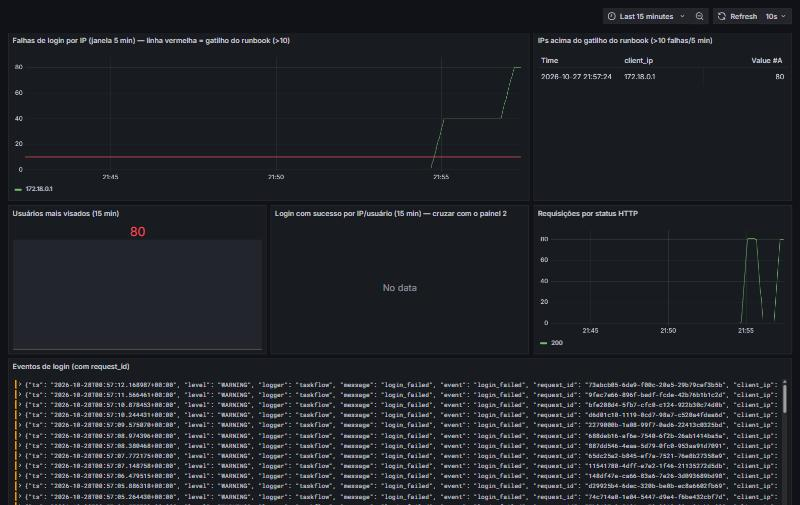

# Observabilidade (Módulo 6)

## Logging estruturado

A TaskFlow escreve **uma linha JSON por evento** no stdout e, no Compose, também em `/app/logs/taskflow.log`, um volume que o Promtail lê como somente-leitura. Exemplo real de `login_failed`:

```json
{"ts": "2026-10-27T23:50:28.853936+00:00", "level": "WARNING", "logger": "taskflow",
 "message": "login_failed", "event": "login_failed",
 "request_id": "802dbc3b-6c84-4aea-9475-f3c28d36ccd3", "client_ip": "172.19.0.1",
 "method": "POST", "path": "/login", "user_agent": "bruteforce-sim/1.0",
 "username": "admin", "reason": "unknown_user"}
```

| Evento | Campos específicos | Quando |
|---|---|---|
| `login_success` | `username`, `user_id` | Login válido |
| `login_failed` | `username`, `reason` (`unknown_user`/`bad_password`) | Login inválido |
| `task_created` | `user_id`, `task_id`, `title_len` | Criação de tarefa |
| `task_list` | `user_id`, `count`, `has_query` | Listagem e busca |
| `logout` | `user_id` | Logout |
| `http_request` | `status`, `duration_ms` | Toda requisição, exceto `/healthz` |

Todo evento carrega `request_id`, `client_ip`, `method`, `path` e `user_agent`.

- **`request_id`:** é um UUID gerado por requisição. Se o proxy enviar `X-Request-ID` com formato válido, ele é reaproveitado, e o mesmo ID aparece no log do nginx, no log da app e no header `X-Request-ID` da resposta.
- **`client_ip`:** o IP real vem do `X-Forwarded-For` via `ProxyFix`, que confia em exatamente 1 salto (o proxy do Compose).

**O que nunca vai para o log:** senha, token CSRF, cookie, `Authorization` e o conteúdo das tarefas.
- O login registra só o `username`, nunca `request.form`.
- O formatter descarta qualquer campo chamado `password`, `token`, `csrf_token`, `cookie`, `session` ou `secret`, mesmo que alguém passe por engano.
- O teste `test_logs_are_json_without_secrets` garante isso. Na simulação, a busca por `senha-errada` no Loki retorna **0 linhas**.

**Labels no Loki:** só `job`, `level` e `event`, que têm baixa cardinalidade. IP, usuário e `request_id` ficam no corpo JSON e são extraídos na consulta com `| json`, para não explodir o índice.

## Stack

```bash
cp .env.example .env            # e troque os valores
docker compose up -d --build
# TaskFlow: http://127.0.0.1:8080  |  Grafana: http://127.0.0.1:3000 (usuário/senha do .env)
docker compose run --rm app flask --app 'app:create_app()' create-user <usuario>
```

O datasource Loki e o dashboard **TaskFlow → "TaskFlow - Segurança e Login"** já sobem provisionados.

## Consultas LogQL usadas pelo grupo

**1. Falhas de login por IP (pergunta: "quem está tentando adivinhar senha?")**, usada no painel 1 e **gatilho do runbook**:
```logql
sum by (client_ip) (count_over_time({job="taskflow", event="login_failed"} | json [5m]))
```
Versão com o limiar do runbook (painel 2):
```logql
sum by (client_ip) (count_over_time({job="taskflow", event="login_failed"} | json [5m])) > 10
```

**2. Usuários mais visados (pergunta: "qual conta está sob ataque?")**, painel 3:
```logql
topk(5, sum by (username) (count_over_time({job="taskflow", event="login_failed"} | json [15m])))
```

**3. Login com sucesso por IP/usuário (pergunta: "o atacante conseguiu entrar?")**, painel 4. Cruzar com os IPs da consulta 1:
```logql
sum by (client_ip, username) (count_over_time({job="taskflow", event="login_success"} | json [15m]))
```

**4. Requisições por status (pergunta: "o serviço está degradado?")**, painel 5:
```logql
sum by (status) (count_over_time({job="taskflow", event="http_request"} | json [1m]))
```

**5. Seguir uma requisição ponta a ponta (pergunta: "o que aconteceu nesta requisição?")**:
```logql
{job="taskflow"} | json | request_id="802dbc3b-6c84-4aea-9475-f3c28d36ccd3"
```

**6. Prova de que nada sensível foi logado** (deve retornar vazio):
```logql
{job="taskflow"} |~ "(?i)senha-errada|password=|csrf_token"
```

## Resultado da simulação (local)

Rodamos `scripts/simular-forca-bruta.sh http://127.0.0.1:8080 admin 25`. A consulta 1 com o limiar do runbook retornou:

```json
{"metric":{"client_ip":"172.19.0.1"},"value":[1793145189.235,"25"]}
```

São 25 falhas em 5 minutos, vindas de um único IP. O `172.19.0.1` é o gateway da rede Docker, ou seja, o host que disparou o script. A consulta 6 retornou 0 linhas.

### Evidência no Grafana

Nova execução com 2 × 40 tentativas (`scripts/simular-forca-bruta.sh http://127.0.0.1:8080 admin 40`). O IP aparece como `172.18.0.1`, o gateway da rede Docker nesta subida da stack.



- **Painel 1:** a série de `172.18.0.1` passa da linha vermelha do gatilho (>10) e chega a 80 falhas na janela de 5 min.
- **Painel 2** (a query de disparo do runbook): lista `172.18.0.1` com 80.
- **Painel 4** (login com sucesso): *No data*, ou seja, o ataque não teve sucesso e a severidade fica Média.
- **Painel 6:** os eventos `login_failed` com `request_id`, sem senha. A busca por `senha-errada` em todos os logs não retornou nada.
